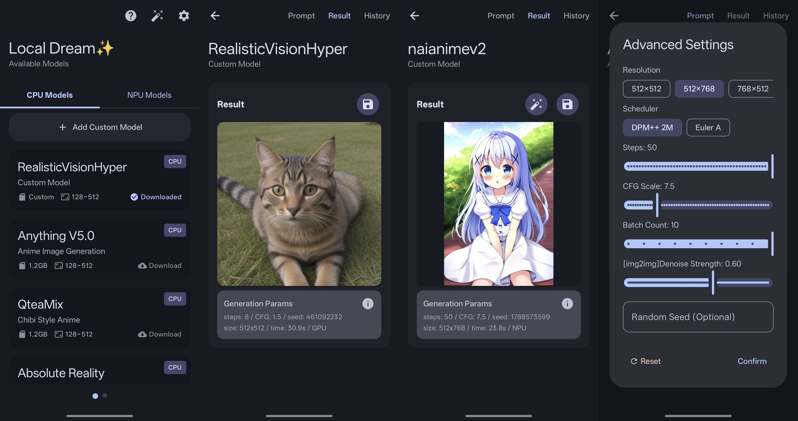

# Local Dream 

**Android Stable Diffusion with Snapdragon NPU acceleration**  
_Also supports CPU/GPU inference_

## About this Repo

This project is **now open sourced and completely free**. Hope you enjoy it!

If you like it, please consider [sponsor](#-support-this-project) this project.

> [!NOTE]
> Currently focused on SD1.5 and SDXL models. SD2.1 is no longer maintained due to poor quality and limited popularity.
>
> **NPU support:**
>
> - SD1.5 models are supported on Snapdragon NPUs with Hexagon V68 architecture or newer.
> - SDXL models are supported on Snapdragon 8 Gen 3 and newer devices.
>
> CPU/GPU inference supports SD1.5 and imported SDXL MNN packages. Large SDXL
> models require substantially more memory than SD1.5.
>
> You can join our [telegram group](https://t.me/local_dream) for discussion or help with testing.

## GPU backend behavior

For MNN-backed CPU models, the GPU option now selects the best available mobile GPU
backend in this order:

1. **Vulkan** — preferred when the Android device exposes a working Vulkan driver.
2. **OpenCL** — compatibility fallback for devices whose Vulkan session cannot be created.
3. **CPU** — final fallback, so GPU selection does not make unsupported devices unusable.

The MNN Android build enables both `MNN_VULKAN` and `MNN_OPENCL`. MNN loads the
device graphics drivers at runtime; the app does not bundle a generic Vulkan driver.
The existing GPU toggle and saved `use_opencl` request field remain compatible.

This path accelerates the MNN-backed SD1.5 CPU pipeline and imported SDXL MNN
packages. Snapdragon QNN/NPU models and the separate DiT engine keep their own
runtimes; selecting this GPU option does not redirect those engines.

## Upstream provenance and license

This repository is a modified derivative of
[Local Dream](https://github.com/xororz/local-dream) by xororz. The upstream
license and copyright notices are retained in [LICENSE](./LICENSE). Changes in
this fork include Vulkan-first MNN GPU selection with OpenCL/CPU fallback and
an Android build workflow.

The upstream project is licensed under **CC BY-NC 4.0**. Attribution is required
and the license permits use and distribution only for non-commercial purposes;
commercial use requires separate permission from the relevant rights holders.

## User Guide

For certain reasons, all guides and documentation have been moved to [Guide Site](https://ld-guide.chino.icu).

## Credits & Acknowledgments

Local Dream is built on top of many excellent open-source projects. Sincere thanks to all the authors and contributors whose work made this project possible.

### C++ Libraries

- **[Qualcomm QNN SDK](https://www.qualcomm.com/developer/software/qualcomm-ai-engine-direct-sdk)** - NPU model execution
- **[alibaba/MNN](https://github.com/alibaba/MNN/)** - CPU model execution
- **[happyyzy/stable-diffusion.cpp](https://github.com/happyyzy/stable-diffusion.cpp)** - Deep performance optimizations for on-device DiT inference
- **[xtensor-stack](https://github.com/xtensor-stack)** - Tensor operations & scheduling
- **[mlc-ai/tokenizers-cpp](https://github.com/mlc-ai/tokenizers-cpp)** - Text tokenization
- **[yhirose/cpp-httplib](https://github.com/yhirose/cpp-httplib)** - HTTP server
- **[nothings/stb](https://github.com/nothings/stb)** - Image processing
- **[facebook/zstd](https://github.com/facebook/zstd)** - Model compression
- **[nlohmann/json](https://github.com/nlohmann/json)** - JSON processing

### Android Libraries

- **[square/okhttp](https://github.com/square/okhttp)** - HTTP client
- **[coil-kt/coil](https://github.com/coil-kt/coil)** - Image loading & processing
- **[MoyuruAizawa/Cropify](https://github.com/MoyuruAizawa/Cropify)** - Image cropping
- **AOSP, Material Design, Jetpack Compose** - UI framework

### Models

- **[CompVis/stable-diffusion](https://github.com/CompVis/stable-diffusion)** and all other model creators
- **[xinntao/Real-ESRGAN](https://github.com/xinntao/Real-ESRGAN)** - Image upscaling
- **[Kim2091/UltraSharpV2](https://huggingface.co/Kim2091/UltraSharpV2)** - Image upscaling
- **[bhky/opennsfw2](https://github.com/bhky/opennsfw2)** - NSFW content filtering

---

## 💖 Support This Project

If you find Local Dream useful, please consider supporting its development:

### What Your Support Helps With:

- **Additional Models** - More AI model integrations
- **New Features** - Enhanced functionality and capabilities
- **Bug Fixes** - Continuous improvement and maintenance

Your sponsorship helps maintain and improve Local Dream for everyone!
